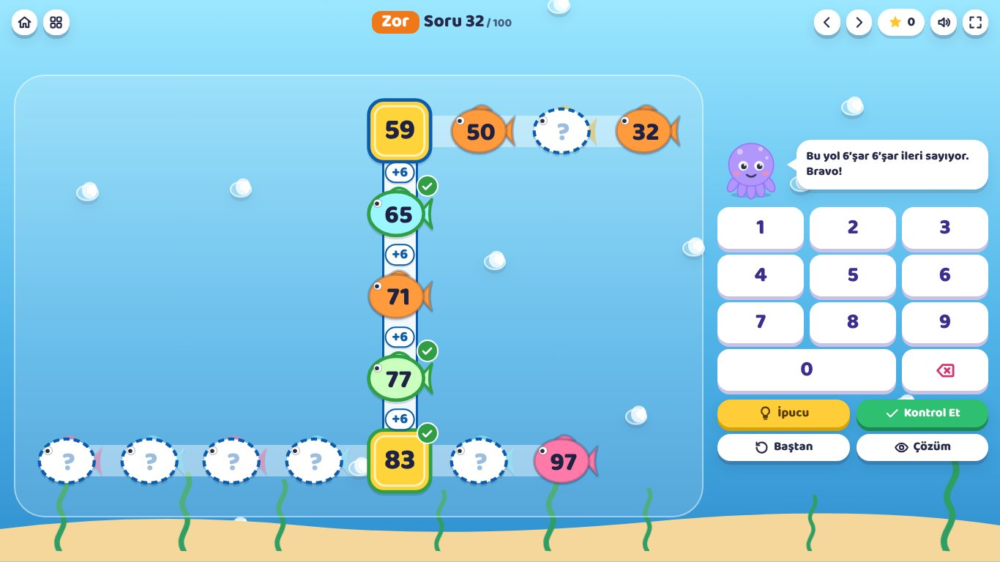

# Ritmik Sayma Macerası

İlkokul öğrencileri için ritmik sayma bulmacaları. Her yoldaki sayılar hep aynı adımla artar ya da azalır; çocuk boş kutulara doğru sayıları yazar. Kare kutular iki yolun ortak kutusudur, bir yolda bulunan sayı öbür yolu çözmeye yarar.



## İçerik

- 4 seviye, toplam 400 soru (her seviyede 100 soru, seviye içinde kolaydan zora sıralı).
- Kolay: 2’şer, 3’er, 4’er, 5’er ve 10’ar ileri sayma. Her yolda yan yana iki sayı verilir.
- Orta: 2’den 10’a kadar adımlar, geri sayan yollar, ortak kutudan öbür yola geçme.
- Zor: 6’şar, 7’şer, 8’er, 9’ar sayma; üç ya da dört yol, 200’e kadar sayılar.
- Çok Zor: 11’er, 12’şer, 15’er, 20’şer, 25’er, 50’şer, 100’er sayma; # ve çerçeve şekilleri, 999’a kadar sayılar.
- Sekiz tema ve her temanın kendi maskotu: balonlar, arı kovanı, uzay, çiçek bahçesi, elma bahçesi, deniz altı, şeker diyarı, kurbağa gölü.
- Ekran tuş takımı ve klavye, Kontrol Et, üç aşamalı İpucu, Çözüm, yıldızlar, ses efektleri, tam ekran.
- "Nasıl oynanır?" penceresinde 70 saniyelik tanıtım videosu ve ders kitabındaki örneğe benzeyen bir örnek soru.

Her soru bilgisayarla denetlendi: çözümü tektir ve "iki sayısı belli olan yolu tamamla" adımı tekrarlanarak bulunabilir. Oyun içinde de 400 sorunun hepsi doğru cevapla, yanlış cevapla ve yalnız ipucuyla otomatik olarak çözdürülerek sınandı.

## Dosyalar

- `index.html`: oyunun kendisi. Tek dosyadır; yazı tipi ve sorular içine gömülüdür, internet olmadan da açılır.
- `video/`: tanıtım videosu (`nasil-oynanir.mp4`), kapak resmi ve ekran görüntüsü.
- `kaynak/`: oyunun kaynak dosyaları, yazı tipleri ve araçlar.

## Değişiklik yapmak

```
python3 kaynak/gen.py      # 400 soruyu yeniden üretir -> kaynak/sorular.json
python3 kaynak/build.py    # index.html dosyasını yeniden derler
```

Sorular sabit bir tohum değeriyle (`SEED`, `kaynak/gen.py`) üretilir; aynı değerle hep aynı 400 soru çıkar. Seviyelerin adım aralıkları, sayı sınırları ve şekilleri `gen.py` içindeki `LEVELS` listesindedir.

Görünüm ve oyun akışı:

- `kaynak/style.css`: renkler, yerleşim, animasyonlar
- `kaynak/art.js`: hücre şekilleri, maskotlar, ikonlar, arka plan süsleri
- `kaynak/main.js`: oyun kuralları, ipucu, yıldızlar, ses
- `kaynak/template.html`: sayfa iskeleti

Tanıtım videosu `kaynak/record.js` ile (Playwright, kare kare çekim) ve `kaynak/audio.py` ile (ses efektleri ve fon müziği) hazırlandı; ffmpeg ile birleştirildi.

## Notlar

- Yıldızlar sayfa açık kaldığı sürece tutulur, sayfa yenilenince sıfırlanır.
- Yazı tipi: Baloo 2, SIL Open Font License 1.1. Lisans metni `kaynak/OFL-Baloo2.txt` dosyasındadır.
